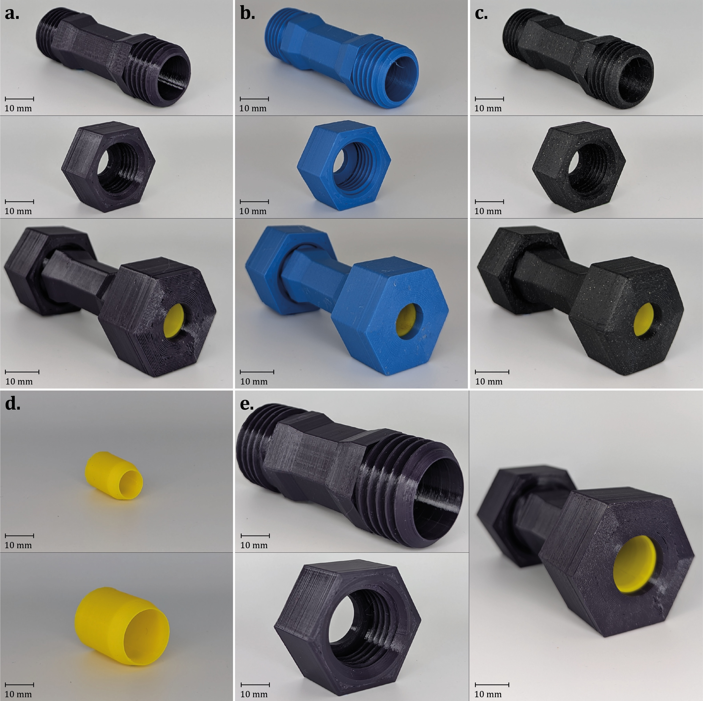
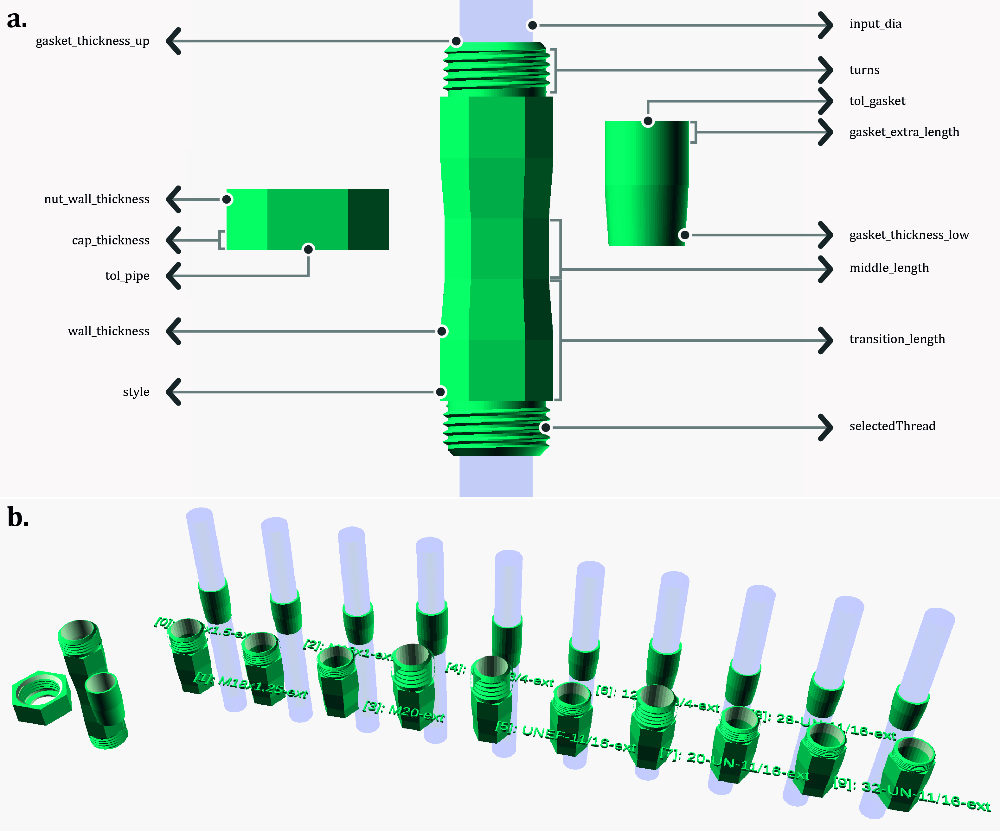
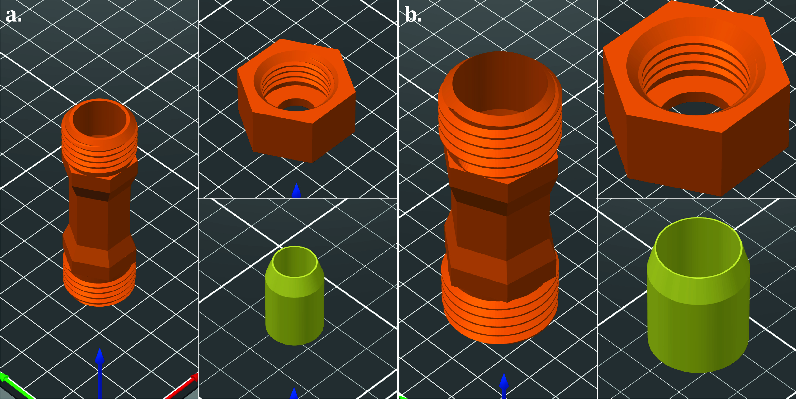
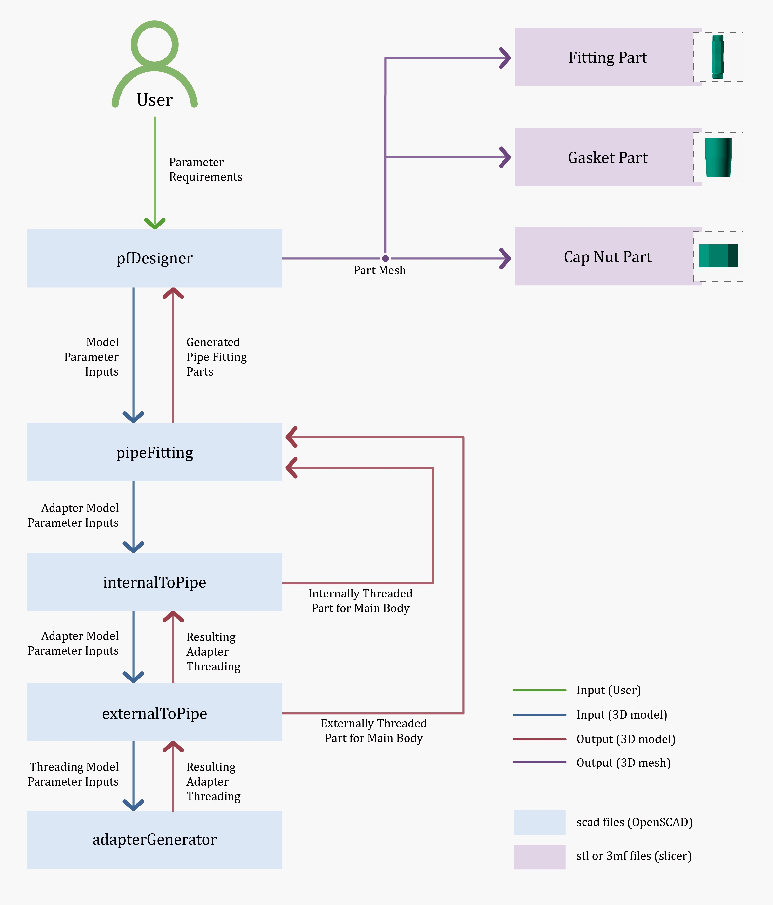

# pipe-fitting-SCAD

OpenSCAD script for generating pipe fittings parametrically.

## Overview

This repository contains a script for modeling a pipe fitting assembly, complete with gaskets, threaded nuts, and customizable pipe fittings. The script is designed for use in OpenSCAD and offers extensive customization for each component while adhering to existing industry thread standards.

**Note:** By using this library, you accept full personal responsibility for its use and any resulting outcomes, and irrevocably agree to the terms outlined in the [legal disclaimer](docs/DISCLAIMER.md). _In short, you are agreeing to assume all risks associated with its use._



## Dependencies

- OpenSCAD software.
- [`threadlib`](https://github.com/adrianschlatter/threadlib) by Adrian Schlatter. Use release 0.5. With the code at [`archive/table-3`](https://github.com/uwo-fast/pipe-fitting-SCAD/tree/archive/table-3), versions 0.3 and later reproduce the tested fittings and nuts, but which version generated them is not recorded.
- The three libraries `threadlib` itself needs: [`scad-utils`](https://github.com/openscad/scad-utils), [`list-comprehension-demos`](https://github.com/openscad/list-comprehension-demos) and [`thread_profile.scad`](https://github.com/MisterHW/IoP-satellite/blob/master/OpenSCAD%20bottle%20threads/thread_profile.scad).

## Installation

1. Ensure OpenSCAD is installed on your system.
2. Open your libraries folder from OpenSCAD with File > Show Library Folder.
3. Download all of the libraries above and this repository into it, so that it looks like this. A downloaded zip adds a suffix such as `-main` to the folder name, which you need to remove.

```text
libraries
├── list-comprehension-demos/
├── pipe-fitting-SCAD/
├── scad-utils/
├── thread_profile.scad
└── threadlib/
```

If a library is missing, OpenSCAD can still export a fitting with no threads and report success. Check the console for `Can't open library` warnings, and check that the threads are there before printing.

## Usage

### Creating your Fitting

Modify the dimensional variables at the beginning of the pfDesigner.scad script to customize the pipe, gasket, fitting, nuts, and threads.



### Manufacturing your Fitting

The tested fittings and nuts were printed in PLA, PETG and ASA, and the gaskets in TPE 85 Shore A, using 0.4 mm nozzles and PrusaSlicer 2.8.0. The STLs, slicer profiles and G-code are on [OSF](https://osf.io/fqjxe/). Print settings are in the paper's Table 3, though some differ from the OSF G-code.



### Performance Testing

**These results are not a guarantee of safety or a pressure rating. Test your own parts, and take proper precautions when working with pressurised water.**

The paper tested printed couplings with water pressure, raised in steps of 0.345 MPa (50 psi) held for 180 s each, until the coupling leaked or lost pressure. The highest pressures reached were:

| Coupling | Highest pressure | Torque |
|---|---|---|
| 10 mm, PETG body and nuts | 4.551 MPa (660 psi) | Highest without cracking: 12.5 Nm |
| 10 mm, ASA | 2.758 MPa (400 psi) | Highest without cracking: 15 Nm |
| 10 mm, PLA | 2.275 MPa (330 psi) | Highest without cracking: 7.5 Nm |
| 20 mm, PETG | 2.392 MPa (347 psi) | Reached at 17.5 Nm |

All gaskets were TPE 85 Shore A. The figures were read by hand from an analog gauge with an accuracy of ±0.138 MPa (±20 psi). That is the gauge's accuracy, not the spread between parts. The readings for each test were not kept, so the number of tests behind each figure is not known.

The far end of each test coupling was closed with a capped nut and a flat 2 mm disc gasket, rather than a second pipe. Set `selectedPart` to `closed_nut` or `flat_gasket` to generate them. The parts used in the tests are on [OSF](https://osf.io/fqjxe/). So each test loaded one tapered gasket sealing on a pipe. Which end leaked was not recorded.

These are the highest pressures held for a few minutes by these particular parts. They are not working pressures. The tests did not cover pressure held for long periods, repeated pressure cycles, water temperature, ageing, or repeated assembly. The 20 mm coupling reached about half the pressure of the 10 mm one, so results at one size do not carry over to another. The paper compares 4.551 MPa with a 0.552 MPa residential limit, which is about eight times higher. That ratio is not a safety factor.


## How it Works



## Publication Archive

The paper's Data Availability Statement refers to an archived `jmmp` branch. That branch is now the tag [`archive/jmmp`](https://github.com/uwo-fast/pipe-fitting-SCAD/tree/archive/jmmp), at the same commit (`75c1e87`).

The values in the paper's Table 3 apply to the tag [`archive/table-3`](https://github.com/uwo-fast/pipe-fitting-SCAD/tree/archive/table-3) (`7a59d5b`). The two rows Table 3 labels `middle_length` are the `lower_length` and `mid_height` inputs at that tag. Later code replaced those inputs with `middle_length` and `transition_length` and changed what they drive, so Table 3's numbers do not carry over. At the tag, Table 3's values reproduce the OSF fittings, nuts and 20 mm gasket. The OSF 10 mm gasket STL is 1 mm longer than Table 3's value gives.

The `10mm_test` and `20mm_test` presets keep the tested inputs. The current code keeps the fitting's full wall thickness at the threaded tip, where the tested fittings thinned to an edge, so its fittings differ slightly from the tested ones. Use the tag for the exact tested geometry.

## Contributing & Requests

Contributions to improve the script or extend its capabilities are welcome. Please submit pull requests with clear descriptions of changes and additions. Similarly, submit an issue to request a fix or addition with a clear description of the bug or feature to be addressed.

## License

Copyright (C) 2023 Cameron K. Brooks and FAST Lab, Western University.

Licensed under the GNU General Public License, version 3 only (GPL-3.0-only). See the [LICENSE](LICENSE) file.

The files in `adaptersMod/` are adapted from Makrokaba's generator (see below). Its 2020 versions are under the BSD 3-Clause terms kept in those files' headers.

## Acknowledgement

This was originally created by Cameron Brooks under the auspices of [FAST Research Group](https://www.appropedia.org/FAST) and published in:

Taherzadeh Fini, A.; Brooks, C.K.; Romani, A.; Straatman, A.G.; Pearce, J.M. Parametric Design of Easy-Connect Pipe Fitting Components Using Open-Source CAD and Fabrication Using 3D Printing. _J. Manuf. Mater. Process._ **2025**, _9_, 65. <https://doi.org/10.3390/jmmp9020065>

The design is certified by the Open Source Hardware Association as [CA000069](https://certification.oshwa.org/ca000069.html).

This design uses [threadlib by Adrian Schlatter](https://github.com/adrianschlatter/threadlib) and builds on [Makrokaba's universal thread and pipe joint generator](https://www.thingiverse.com/thing:4323468), which the files in `adaptersMod/` were adapted from.
